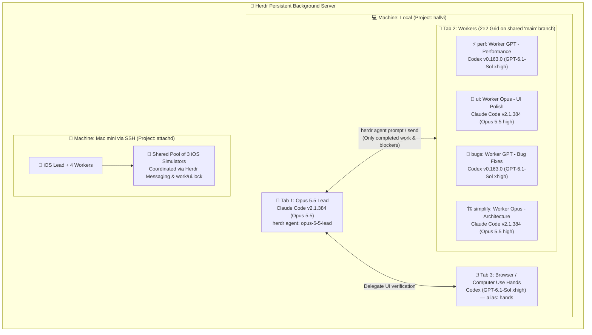

# 🐄 Herdr: Beginner To Advanced in 15 min (Basics, Multi-Agent, Remote Machines & Persistent Runtime)

## 📋 Metadata
- **Video Title:** Herdr: Beginner To Advanced in 15 min (Basics, Multi-Agent, Remote Machines…)
- **Channel / Creator:** Lyubomir Stoykov (`lustoykov`)
- **URL:** https://www.youtube.com/watch?v=WTmCkYMelIU
- **Duration:** 15:44
- **Watch Skill ID:** `cc426a3acb3d1f9f`
- **Frames Inspected:** 21 frames (`frame_0000.jpg` – `frame_0020.jpg` in `C:\Users\Admin\.watch-skill\frames\cc426a3acb3d1f9f\`)
- **Date Processed:** 2026-11-07
- **Topic:** Multi-Agent Terminal Runtime (`herdr`), Self-Orchestrating Lead + 2×2 Worker Grid, Single-Branch (`main`) Coordination, Remote SSH Machines & Shared Resource Pools

---

## 🎯 Tóm tắt cốt lõi (Executive Summary)

Lyubomir Stoykov (`lustoykov`) hướng dẫn toàn diện từ cơ bản đến nâng cao về **Herdr** (`herdr.dev` — *"Run them anywhere. Leave them running."*) — một **Agent Runtime / Terminal Multiplexer** mã nguồn mở (Apache 2.0) được thiết kế chuyên biệt cho thời đại chạy 10–20+ AI coding agents song song:

1. **Không phải wrapper trên `tmux`:** Herdr được viết mới hoàn toàn từ đầu nhưng hỗ trợ **song song cả hai trường phái**: thao tác chuột trực quan (click phải để split pane, đóng pane, kéo thả) lẫn bộ phím tắt chuẩn `tmux` (`Ctrl+B` prefix, `?` xem bảng phím tắt, `/` tìm kiếm phím tắt).
2. **File Skill tích hợp sẵn (`herdr --skill`) — Chìa khóa tự điều phối (Self-Orchestration):** Khi cấp cho Lead Agent file skill của Herdr (`herdr --skill` hoặc `npx skills add herdrdev/herdr --skill herdr -g`), bạn không cần tự tạo từng pane thủ công nữa. Chỉ cần ra lệnh bằng ngôn ngữ tự nhiên, Lead Agent sẽ tự chạy lệnh CLI `herdr` để đổi tên tab/pane của chính nó, tạo tab `Workers` mới, chia lưới **2×2 gồm 4 Worker Agents** (pha trộn giữa `Claude Opus 5.5` và `OpenAI Codex GPT-6.1-Sol xhigh`), đặt tên định danh và gửi prompt giao việc cho từng worker.
3. **Chiến lược Single-Branch (`main`) thay vì lạm dụng Git Worktrees:** Khi chạy 10–20 agents với git worktrees, ổ cứng nhanh chóng bị tràn bởi hàng chục bản copy `node_modules` / build artifacts và lúc merge lại cực kỳ đau đầu. Giải pháp thực chiến của Lyubomir: cho tất cả workers **dùng chung một checkout trên nhánh `main`** và tự điều phối qua hệ thống nhắn tin nội bộ của Herdr (`herdr agent prompt`), chỉ tạo worktree khi thực sự bất khả kháng.
4. **Remote Machines qua SSH & Persistent Background Server:** Kết nối máy Mac mini ở phòng khác vào cùng một giao diện Herdr (`herdr machine add mac-mini --label "Mac mini"`) để offload tác vụ build iOS nặng và điều phối **pool 3 iOS Simulators dùng chung** giữa các agents. Đóng hoàn toàn cửa sổ terminal không làm chết agents — gõ `herdr` là kết nối lại ngay lập tức.

---

## Architecture & Multi-Agent Topology trong Herdr



---

## ⏱️ Phân tích chi tiết theo dòng thời gian & Visual Frames

### 1. Giới thiệu Herdr & Cài đặt (`00:00` – `02:30` | `frame_0000` – `frame_0007`)
- **Trang chủ `herdr.dev` (`frame_0001`, `frame_0002`):**
  - Tagline: *"Run them anywhere. Leave them running."* — **THE AGENT RUNTIME**.
  - Thống kê hệ sinh thái hiển thị trực tiếp trên trang chủ (`frame_0002`):
    - **`44,946`** GitHub Stars
    - **`1,691,340`** lượt cài đặt
    - **`1,828`** community plugins
    - **`22`** Agent CLIs được tự động nhận diện (Claude Code, Codex, OpenCode, Pi, Gemini CLI, Cursor CLI, v.v.).
  - **Lệnh cài đặt (`frame_0002`, `frame_0003`):**
    ```bash
    curl -fsSL https://herdr.dev/install.sh | sh
    ```
    Hỗ trợ đầy đủ **macOS, Linux, Windows** (bản quyền **Apache 2.0**), có sẵn trên `winget`, `homebrew`, và `nix`.
- **Tổng quan giao diện nâng cao (`frame_0004` – `frame_0006`):**
  - Thanh sidebar bên trái hiển thị danh sách **Workspaces** và trạng thái trực tiếp của từng Agent (Lead, 4 Workers trong lưới 2×2, và agent `hands` chuyên phụ trách Browser/Computer Use vì `GPT-6.1-Sol` mạnh về thao tác máy tính hơn `Opus 5.5`).

---

### 2. Bí quyết quan trọng nhất: Cài đặt `herdr --skill` cho AI Agents (`02:31` – `03:54` | `frame_0007` – `frame_0008`)
- Nhiều người cài Herdr xong chỉ dùng nó như một terminal chia màn hình thông thường và bỏ lỡ 80% sức mạnh thực sự.
- **Cách kích hoạt khả năng tự điều phối (`frame_0007`, `frame_0008`):**
  - Chạy lệnh in tài liệu skill tích hợp sẵn:
    ```bash
    herdr --skill
    ```
  - Hoặc cài trực tiếp vào kho global skills cho mọi coding agent trên máy:
    ```bash
    npx skills add herdrdev/herdr --skill herdr -g
    ```
- **Nội dung bên trong file Skill (`frame_0008`):**
  - Cung cấp cho AI agent các biến môi trường tự nhận diện vị trí của nó (`$HERDR_PANE_ID`, `$HERDR_TAB_ID`, `$HERDR_WORKSPACE_ID`) và bộ lệnh CLI đầy đủ:
    - Kiểm tra bố cục hiện tại: `herdr pane layout --pane "$HERDR_PANE_ID"`
    - Tự tách pane mới: `herdr pane split --current --direction right --cwd "$PWD" --no-focus`
    - Đặt tên định danh cho agent và giao tiếp liên-agent: `herdr agent set-name`, `herdr agent prompt <target> "<message>"`.

---

### 3. Hệ thống Đèn Trạng thái, Âm báo & Phím tắt `tmux` (`03:55` – `06:12` | `frame_0009` – `frame_0011`)
- **Bảng Settings (`frame_0009`, `frame_0010`):**
  - Mở bằng nút bánh răng góc dưới bên trái hoặc phím tắt `Ctrl+B` rồi nhấn `s`.
  - Hỗ trợ hàng loạt bộ theme chuẩn terminal: `catppuccin`, `catppuccin-latte`, `tokyo-night`, `dracula`, `nord`, `gruvbox`, `solarized`...
  - **Ý nghĩa hệ thống chấm màu trạng thái (Status Indicators - `04:30`):**
    - 🟢 **Xanh lá (Green):** Agent đang rảnh (Idle / Waiting for input).
    - 🟡 **Vàng (Yellow):** Agent đang chạy tác vụ (Working).
    - 🔴 **Đỏ (Red):** Agent đang bị chặn / cần quyền phê duyệt hoặc câu trả lời từ người dùng (Blocked / Needs input).
    - 🔵 **Xanh lơ (Cyan):** Agent vừa hoàn thành xong công việc (Done working).
  - **Quản lý âm báo (Sound Notifications):** Khi mới chạy 1–2 agents thì âm báo rất tiện, nhưng khi chạy tới **20 agents song song**, tiếng ping liên tục sẽ gây mất tập trung — có thể tắt ngay trong Settings.
- **Chuột + Phím tắt `tmux` (`frame_0011`):**
  - Click chuột phải vào bất kỳ đâu trong pane để mở menu `Split right`, `Split down`, `Close pane`.
  - Nhấn `Ctrl+B` rồi `?` để mở bảng **Keybinds Modal** (`frame_0011`), nhấn `/` để tìm kiếm nhanh (`prefix+v` chia dọc, `prefix+x` đóng pane, `prefix+q` detach, `prefix+shift+r` reload config, `prefix+o` nhảy tới thông báo mới nhất).

---

### 4. Tự động dựng Đội hình Lead + 2×2 Multi-Agent Grid bằng Ngôn ngữ Tự nhiên (`06:13` – `10:34` | `frame_0012` – `frame_0016`)
- **Bước 1 — Yêu cầu Lead Agent tự định danh chính mình (`frame_0012`, `frame_0013`):**
  - Trong project `hallvi`, Lyubomir khởi chạy `Claude Code v2.1.384` (`Opus 5.5`) và gõ prompt:
    > *"Use herdr skill to rename your current tab, pane label, and Herdr agent name to Opus 5.5 Lead, and also queue /rename Opus 5.5 Lead inside Claude Code once you're idle."*
  - Ngay lập tức, Claude đọc skill Herdr và thực thi chuỗi lệnh (`frame_0013`):
    - Đổi tên tab → `Opus 5.5 Lead`
    - Đổi nhãn pane → `Opus 5.5 Lead`
    - Đặt Herdr agent name → `opus-5-5-lead`
    - Tự xếp hàng lệnh `/rename Opus 5.5 Lead` vào phiên Claude Code của chính nó khi vừa chuyển sang trạng thái idle!
- **Bước 2 — Yêu cầu Lead Agent tự tạo Tab `Workers` chia lưới 2×2 gồm 4 Agents hỗn hợp (`frame_0014` – `frame_0016`):**
  - Thay vì tự tay chia 4 màn hình, khởi chạy từng CLI và gõ tên từng pane, Lyubomir giao thẳng cho `Opus 5.5 Lead`:
    > *"Create a new tab called `Workers` in this same workspace with a 2x2 grid of 4 fresh workers for this repo: 2 OpenAI Codex (`GPT-6.1-Sol xhigh` in YOLO mode) and 2 Claude Code (`Opus 5.5 high`)."*
  - `Opus 5.5 Lead` tự động dựng tab `Workers` (`frame_0015`, `frame_0016`) với 4 ô vuông cân đối, khởi chạy đúng CLI trong từng ô và gán nhãn chuyên biệt:
    1. **Ô trên-trái (`perf`):** `"Worker GPT - Performance"` — chạy `OpenAI Codex v0.163.0` (`gpt-6.1-sol xhigh`, `--dangerously-bypass-approvals-and-sandbox`).
    2. **Ô trên-phải (`ui`):** `"Worker Opus - UI Polish"` — chạy `Claude Code v2.1.384` (`Opus 5.5 high`).
    3. **Ô dưới-trái (`bugs`):** `"Worker GPT - Bug Fixes"` — chạy `OpenAI Codex v0.163.0` (`gpt-6.1-sol xhigh`).
    4. **Ô dưới-phải (`simplify`):** `"Worker Opus - Architecture"` — chạy `Claude Code v2.1.384` (`Opus 5.5 high`).

---

### 5. Điều phối Single-Branch (`main`) — Tại sao bỏ Git Worktrees khi chạy 10–20 Agents? (`10:35` – `12:14`)
- **Vấn đề thực tế với Git Worktrees:**
  - Khi chạy 10–20 agents mà mỗi agent tạo một git worktree riêng, ổ cứng nhanh chóng cạn sạch dung lượng do nhân bản thư mục dependencies/build caches, đồng thời bước rebase/merge 10 nhánh lệch nhau vào cuối ngày cực kỳ dễ vỡ.
- **Mẫu Prompt Điều phối Single-Branch của Lyubomir (`10:55` – `12:10`):**
  > *"Tell all workers: you share the same checkout on `main`, coordinate directly through Herdr messaging. Make routine decisions autonomously and only message the lead with completed work, unresolved blockers, or important decisions needing input. Skip chatter and routine progress updates. If you truly need isolation, you have permission to create a git worktree."*
- **Hai quy tắc vàng trong prompt này:**
  1. **Cấm "chatter" (nhắn tin báo cáo lặt vặt):** Nếu không cấm, 4 workers sẽ liên tục bắn tin nhắn cập nhật tiến độ vào hộp thư của Lead Agent làm loãng context và tốn token vô ích. Chỉ nhắn khi **hoàn thành xong việc**, **gặp blocker không tự gỡ được**, hoặc **cần quyết định kiến trúc**.
  2. **Chia sẻ cùng nhánh `main` nhưng giao phạm vi file/mục tiêu rõ ràng:** Lead Agent phân công nhiệm vụ độc lập cho từng worker (`perf`, `ui`, `bugs`, `simplify`) và các worker tự nhắn tin cho nhau qua Herdr nếu cần đụng vào file giao thoa.

---

### 6. Kết nối Remote Machines qua SSH & Quản lý Pool iOS Simulators (`12:15` – `15:44` | `frame_0017` – `frame_0020`)
- **Đưa máy trạm từ xa vào chung một giao diện Herdr (`frame_0017` – `frame_0019`):**
  - Lyubomir có một chiếc **Mac mini** đặt ở phòng khác chuyên dùng để build ứng dụng iOS (`attachd`).
  - Chỉ cần cấu hình SSH chuẩn (`ssh mac-mini` kết nối được không cần mật khẩu) rồi chạy lệnh:
    ```bash
    herdr machine add mac-mini --label "Mac mini"
    ```
  - Ngay lập tức, thanh sidebar bên trái của Herdr chia thành mục **`machines`** (`frame_0018`, `frame_0019`):
    - `Local` (chứa workspace `hallvi` trên MacBook đang ngồi làm việc).
    - `Mac mini` (chứa workspace `attachd` chạy trực tiếp trên phần cứng của Mac mini từ xa, độ trễ gần như bằng 0).
  - Hỗ trợ chuyển đổi góc nhìn sidebar giữa **`grouped`** (gom theo máy/workspace) và **`priority`** (đẩy các agents đang 🔴 Blocked hoặc 🔵 Done lên đầu danh sách bất kể đang chạy ở máy nào).
- **Persistent Background Server & Bài toán Pool 3 iOS Simulators (`14:25` – `15:42` | `frame_0020`):**
  - **Không bao giờ sợ mất phiên khi tắt Terminal:** Ngay cả khi bấm nút đỏ đóng hẳn cửa sổ terminal ứng dụng (`14:35`), toàn bộ 10+ agents trên cả máy Local và Mac mini vẫn tiếp tục chạy ngầm trong Herdr daemon. Mở lại terminal và gõ `herdr` là toàn bộ giao diện, lịch sử log và trạng thái pane hiện lại nguyên vẹn.
  - **Chia sẻ tài nguyên phần cứng hữu hạn (Shared iOS Simulator Pool - `frame_0020`):**
    - Khi chạy 4 workers làm app iOS trên Mac mini, nếu để mặc định, mỗi agent sẽ tự bật thêm các iOS Simulator mới (có lúc lên tới 10 Simulators làm treo cứng máy).
    - Lyubomir cấp sẵn một **Pool cố định gồm 3 iOS Simulators**, và dặn Lead + Workers trên Mac mini tự điều phối lượt dùng Simulator thông qua tin nhắn Herdr và cơ chế lock (`work/ui.lock`).

---

## 🛠️ Tổng hợp Lệnh CLI & Prompt Mẫu áp dụng ngay

| Tác vụ | Lệnh / Prompt |
|--------|---------------|
| **Cài đặt Herdr** | `curl -fsSL https://herdr.dev/install.sh \| sh` |
| **Cài Herdr Skill cho mọi Agent** | `npx skills add herdrdev/herdr --skill herdr -g` (hoặc xem bằng `herdr --skill`) |
| **Thêm máy trạm SSH từ xa** | `herdr machine add <ssh-host> --label "<Tên hiển thị>"` |
| **Prompt tự đặt tên Lead Agent** | `"Use herdr skill to rename your current tab, pane label, and Herdr agent name to Opus 5.5 Lead, and queue /rename Opus 5.5 Lead once idle."` |
| **Prompt dựng lưới 2×2 Workers** | `"Create a new tab called Workers in this workspace with a 2x2 grid of 4 fresh workers (2 Codex GPT-6.1-Sol xhigh YOLO, 2 Claude Opus 5.5 high) for perf, ui, bugs, and simplify."` |
| **Prompt điều phối chung nhánh `main`** | `"Tell all workers: you share the same checkout on main, coordinate directly through Herdr messaging. Only message the lead with completed work, unresolved blockers, or key decisions. Skip routine chatter."` |
