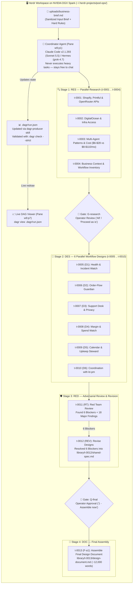

# 🧩 Exploring Herdr Plugins: Multi-Agent Orchestration & Live DAG Workflows (`herdr-projects` + `herdr-dagr`)

## 📋 Metadata
- **Video Title:** Exploring Herdr Plugins: Multi-Agent Orchestration and Workflows
- **Channel / Creator:** Tonbi's AI Garage (`agentwikis.com`)
- **URL:** https://www.youtube.com/watch?v=82S8fmes9T0
- **Duration:** 19:13
- **Watch Skill ID:** `157496f398c0764b`
- **Frames Inspected:** 73 frames (`frame_0000.jpg` – `frame_0072.jpg` in `C:\Users\Admin\.watch-skill\frames\157496f398c0764b\`)
- **Date Processed:** 2026-11-07
- **Topic:** Herdr Community Plugin Ecosystem (`herdr.dev/plugins`), `eliasstravik/herdr-projects` (Coordinator + Isolated Worker Threads), `aemrebarut/herdr-dagr` (Live DAG Swarm TUI), and 4-Stage Adversarial Multi-Agent Design Workflow

---

## 🎯 Tóm tắt cốt lõi (Executive Summary)

**Tonbi's AI Garage** trình bày triết lý mở rộng của **Herdr**: giữ phần nhân (core runtime) cực kỳ tinh gọn và trao quyền mở rộng cho **hệ sinh thái hơn 1,600+ Community Plugins** trên `herdr.dev/plugins` (tự động phát hiện từ topic `herdr-plugin` trên GitHub kèm tệp manifest `herdr-plugin.toml`). Video đi sâu vào sự kết hợp thực chiến giữa 2 plugin điều phối đa tác nhân mạnh nhất hiện nay trên máy chủ **NVIDIA DGX Spark** (Linux `aarch64`):

1. **`eliasstravik/herdr-projects` (Rust, v0.2.34, 585+ stars):** Giải quyết bài toán *"Làm sao giữ một cuộc hội thoại duy nhất luôn rảnh để trả lời bạn trong khi hàng chục tác vụ chạy song song?"*. **Coordinator Agent không bao giờ tự làm việc nặng** — nó chỉ đọc yêu cầu, tách thành các luồng worker độc lập (`t-0001` .. `t-0013`), mỗi worker có thư mục/git worktree và nhánh riêng, dùng chung bộ nhớ (`MEMORY.md`, `PROJECT.md`, `library/`, `inbox/`).
2. **`aemrebarut/herdr-dagr` (Rust, v0.3.1, 93+ stars):** Biến bầy đàn (swarm) hàng chục agents thành một **Đồ thị có hướng không chu trình trực tiếp (Live DAG TUI)** ngay trong pane bên phải của Herdr. Hiển thị rõ từng tầng (`RES` Research → `DES` Workflow Designs → `RED` Red Team → `DOC` Final Document), các cổng phê duyệt (`gates`), số lần thử (`attempts`), trạng thái từng thread và cho phép bấm `d` xem chi tiết hoặc `Enter` nhảy thẳng vào pane của worker đó.
3. **Quy trình 4 Giai đoạn Thiết kế + Phản biện Đối kháng (Adversarial Red-Team Loop) cho hệ thống `POD Ops` (`Keepsake Threads`):**
   - **Giai đoạn 1 (`RES` — 4 luồng Research song song `t-0001`..`t-0004`):** Bắt buộc trích dẫn tài liệu chính thức hoặc gắn nhãn `UNVERIFIED`.
   - **Giai đoạn 2 (`DES` — 6 luồng Design song song `t-0005`..`t-0010`):** Thiết kế 5 làn vận hành + 1 làn điều phối.
   - **Giai đoạn 3 (`RED` — Luồng Red Team đối kháng `t-0011` & Revision `t-0012`):** Phát hiện **6 lỗi chặn đứng (blockers)** nghiêm trọng (injection qua email khách hàng, mâu thuẫn quyền gửi mail, nghẽn luồng đơn hàng đã thanh toán, hết hạn chứng thực AI `2027-01-01`, xung đột GitHub token, rò rỉ PII vào shared ledger) + kiểm chứng chéo API docs (bắt sống lỗi giả định sai rằng đơn hàng `inprocess` của Printful có thể hủy được).
   - **Giai đoạn 4 (`DOC` — Tổng hợp `t-0013`):** Xuất bản tài liệu thiết kế hoàn chỉnh ~12,000 từ (`design-document.md`) kèm ma trận tuân thủ quy tắc cứng và bảng việc cần làm ngay theo ngày.

---

## 🏗️ Kiến trúc Phối hợp `herdr-projects` + `herdr-dagr` (13 Threads Pipeline)



---

## ⏱️ Phân tích chi tiết theo dòng thời gian & Visual Frames

### 1. Chợ Plugin Cộng đồng `herdr.dev/plugins` (`00:00` – `02:02` | `frame_0000` – `frame_0021`)
- **Cơ chế tự động khám phá ("Built by the herd" - `frame_0000`, `frame_0001`, `frame_0041`):**
  - Kho plugin cộng đồng đạt **1,600 plugins** trên **1,546 repositories** (`+1,983 ★` trong tuần, `158` plugin mới gia nhập trong tuần).
  - Bất kỳ ai cũng có thể xuất bản plugin lên GitHub chỉ bằng cách gắn topic **`herdr-plugin`** kèm tệp cấu hình **`herdr-plugin.toml`** — hệ thống chỉ mục của Herdr sẽ tự động quét mà không cần hàng đợi xét duyệt.
  - Cài đặt bất kỳ plugin nào bằng lệnh:
    ```bash
    herdr plugin install <owner>/<repo>
    ```
- **Điểm danh các Plugin nổi bật xuất hiện trên chợ (`frame_0000`, `frame_0005`, `frame_0019`, `frame_0071`, `frame_0072`):**
  - `devseha/herdr-web-ui`: Giao diện trình duyệt & điện thoại cho Herdr (chat + live terminal cho mọi pane, kết nối PC từ xa qua SSH, web push notifications).
  - `deimantasnork/captains-deck`: Bảng Kanban luồng công việc chỉ đọc (read-only) cho Herdr.
  - `hhdabb/herdr-radar`: Theo dõi ai đang làm việc, ai đang đợi bạn — gom nhóm theo project với logo và màu sắc của từng nhà cung cấp model.
  - `arronkler/pairfob` & `AltanS/collie` & `ZingerLittleBee/Heeler`: Các giao diện điều khiển coding agents từ điện thoại (PWA / Native iOS SSH console).
  - `smarzban/tsk`: Giải pháp thay thế Linear chạy ngay trong terminal (shared task board cho người và agents).
  - `CristianonCarvalho/meisterrouter`: Phân bổ tác vụ trong plan qua nhiều gói thuê bao AI CLI (Copilot, Codex, Gemini, Claude), mỗi tác vụ một git worktree kèm cổng kiểm thử tất định (deterministic test gate).
  - `furkankly/zoetrope`: Xem phiên Claude Code hoặc Codex dưới dạng biểu đồ luồng trực tiếp (live flow graph).
  - `plannotator/herdr-annotate`: Ghi chú trực tiếp lên văn bản terminal, duyệt tài liệu của agent và gửi phản hồi ngược về phiên chat.
  - *(Từ `01:14` – `01:52` | `frame_0007` – `frame_0018`: Tonbi giới thiệu nhanh nền tảng `agentwikis.com` — kho kiến thức Markdown có `llms.txt`, 35 skills thực chiến và các specialist profiles cho AI agents).*

---

### 2. Giải phẫu Plugin #1: `eliasstravik/herdr-projects` (`02:03` – `06:04` | `frame_0022` – `frame_0040`)
- **Thông tin Repository (`frame_0023`, `frame_0024`):**
  - Repo: `github.com/eliasstravik/herdr-projects` (Viết bằng **Rust**, phiên bản `v0.2.34`, giấy phép **MIT**, **585 stars**, 43 forks).
- **Triết lý thiết kế cốt lõi (`frame_0026` – `frame_0028`):**
  - *"Keep one conversation going while the work happens in parallel. The coordinator never does the work itself, so it's always free to answer you."*
  - Mỗi tác vụ chạy trong một **thread riêng biệt**: một agent độc lập trong git worktree và nhánh riêng (hoặc thư mục riêng nếu chưa có repo).
  - Bảng so sánh trực quan trên README (`frame_0027`, `frame_0028`) cho thấy `Herdr Projects` đạt tích xanh ✅ ở toàn bộ các tiêu chí so với giao việc thủ công (`Briefing agents by hand`), chạy một phiên dài (`One long agent session`), hoặc dùng dịch vụ đám mây (`Cloud projects products`):
    - Không tốn phí phần mềm phụ trội (`No extra software fee`).
    - Chạy song song trên các nhánh tách biệt (`Parallel tasks on separate branches`).
    - Dùng chung chỉ dẫn và bộ nhớ cho mọi tác vụ (`Same instructions and memory for every task`).
    - Một cuộc hội thoại luôn rảnh để trả lời (`One conversation that stays free to answer`).
    - Gom nhóm các luồng theo thứ cần bạn duyệt (`Threads grouped by what needs you`).
    - Chạy trên chính máy của bạn & tiếp nhận được cả pane agent đã mở sẵn (`Adopts an agent pane you already started`).
- **Cài đặt & Khởi tạo Project trên NVIDIA DGX Spark (`frame_0029` – `frame_0037`):**
  - Do một số plugin ưu tiên Linux/macOS, Tonbi SSH từ PowerShell trên Windows vào máy trạm **NVIDIA DGX Spark** (`ssh tonbi@hibana`, GNU/Linux 6.17.0-1029-nvidia `aarch64`, ổ cứng 3.67TB - `frame_0029`) và kiểm tra `herdr update` (`v0.9.3`).
  - **Bước 1 — Cài đặt plugin (`frame_0030`, `frame_0031`):**
    ```bash
    herdr plugin install eliasstravik/herdr-projects
    ```
    Herdr hiển thị bản xem trước rất minh bạch trước khi hỏi `Install this plugin? [y/N]`: đăng ký 10 actions (`adopt-workspace`, `configure`, `doctor`, `focus`, `new`, `open`, `open-popup`, `pause`, `resume`, `unfocus`), 4 panes (`adopt`, `new`, `pick`, `projects`) và biên dịch binary Rust tại `target/release/herdr-projects`.
  - **Bước 2 — Tạo project `POD Ops` kèm mục tiêu (`frame_0031`, `frame_0032`):**
    ```bash
    herdr-projects new "POD Ops" --goal "Design a multi-agent maintenance workflow for my POD Shopify store"
    ```
    Lệnh này khởi tạo không gian làm việc tại `/home/tonbi/.herdr-projects/pod-ops`.
  - **Bước 3 — Mở Coordinator với bất kỳ Agent Profile nào (`frame_0032` – `frame_0037`):**
    - Mặc định mở bằng Claude Code (`frame_0032`):
      ```bash
      herdr-projects open "pod-ops"
      ```
    - Hoặc chuyển sang dùng **Hermes Agent** (`v0.21.5`, chạy model `grok-4.7` của Nous Research với 28 tools, 123 skills và MCP server `agentwikis` - `frame_0034` – `frame_0036`) chỉ bằng cờ `--profile`:
      ```bash
      herdr-projects open "pod-ops" --profile hermes
      ```
- **Cấu trúc thư mục chuẩn bên trong `~/.herdr-projects/pod-ops/` (`frame_0038` – `frame_0040`, `frame_0061`):**
  - Khi mở trong VS Code Remote SSH (`tonbi [SSH: hibana]`), `herdr-projects` đã tự động dựng sẵn cấu trúc thư mục:
    - `inbox/` — Hộp thư chứa báo cáo từ tất cả các worker threads gửi về Coordinator.
    - `library/` — Thư viện lưu trữ các bản thiết kế, báo cáo nghiên cứu và tài liệu hoàn chỉnh.
    - `memory/` & `MEMORY.md` — Bộ nhớ dài hạn dùng chung của dự án.
    - `routines/` — Các quy trình định kỳ.
    - `scratch/` — Thư mục nháp tạm thời.
    - `threads/` — Chứa các thư mục con cô lập cho từng worker (`t-0001`, `t-0002`, ..., `t-0013`).
    - `uploads/` — Nơi người dùng thả tài liệu đầu vào (Tonbi dán tệp `business-brief.md` mô tả cửa hàng in theo yêu cầu **Keepsake Threads** `https://keepsakethreads.net` chạy trên DigitalOcean App Platform + PostgreSQL `pg-boss` + Shopify Headless + Printful API + OpenRouter).
    - Các tệp điều khiển gốc: `AGENTS.md`, `CLAUDE.md`, `MEMORY.md`, `PROJECT.md`, `TASKS.md`.

---

### 3. Giải phẫu Plugin #2: `aemrebarut/herdr-dagr` (`06:05` – `06:55` | `frame_0041` – `frame_0043`)
- **Thông tin Repository (`frame_0041`, `frame_0042`):**
  - Repo: `github.com/aemrebarut/herdr-dagr` (Viết bằng **Rust**, phiên bản `v0.3.1`, giấy phép kép **Apache-2.0 / MIT**, **93 stars**).
  - Ý nghĩa tên gọi trên README (`frame_0042`): *"Dagr is the Norse personification of day: he rides across the sky once per cycle and illuminates everything below. Also, it's a DAG. With herdr's r."*
- **Cài đặt (`frame_0043`):**
  ```bash
  herdr plugin install aemrebarut/herdr-dagr
  ```
  Hỗ trợ đa nền tảng (có cả script Bash `open-dagr.sh` cho Linux/macOS lẫn PowerShell `open-dagr.ps1` cho Windows) để mở bảng đồ thị DAG ở các hướng `right`, `left`, `up`, `down`.

---

### 4. Thực chiến Quy trình 4 Giai đoạn Thiết kế Hệ thống Multi-Agent `POD Ops` (`06:56` – `18:34` | `frame_0044` – `frame_0069`)

#### Khởi động Coordinator với Prompt Điều phối Tổng thể (`06:56` – `08:04` | `frame_0044` – `frame_0045`)
- Tonbi mở `herdr-projects open pod-ops` (chạy `Claude Code v2.1.293` với `Sonnet 5.5` làm Coordinator) và gửi bản brief điều phối (`frame_0044`):
  > *"Read `uploads/business-brief.md`. I want the design document it asks for. First, propose 3-4 research threads and wait for my go-ahead. After I review the reports, start one design thread per maintenance workflow, then a red-team thread to review the designs. Wait for my approval before assembling the final document. Keep the dagr run file updated the whole time with your `dagr-producer` skill."*
- Coordinator tự động tìm skill `dagr-producer`, khởi tạo tệp `.dagr/run.json` và kiểm tra tính hợp lệ bằng lệnh `dagr check --strict` (`frame_0045`, `frame_0046`).

#### Giai đoạn 1 (`RES`): 4 Luồng Nghiên cứu Song song (`08:05` – `10:48` | `frame_0046` – `frame_0050`)
- Coordinator đề xuất 4 luồng nghiên cứu chỉ đọc (`read-only research`) và đợi lệnh duyệt (`frame_0046`). Khi Tonbi gõ `All` (`frame_0047`), Coordinator lập tức bật 4 worker threads chạy song song dưới dạng các tab (`frame_0048`):
  1. **`t-0001`:** *Shopify, Printful and OpenRouter APIs* (kiểm tra scopes, webhooks, rate limits, per-agent tokens).
  2. **`t-0002`:** *DigitalOcean and infrastructure access* (App Platform logs, alerts, managed Postgres firewall, `pg-boss`).
  3. **`t-0003`:** *Multi-agent patterns and cost* (so sánh 1 ops agent vs đội ngũ specialists, cơ chế single-writer ledgers, leases kèm fencing tokens, shadow mode; ước tính chi phí **\$6–\$28/tháng** cho 1 agent so với **\$8–\$110/tháng** cho đội 3 agents - `frame_0050`).
  4. **`t-0004`:** *Business context and workflow inventory* (kiểm kê từng quy trình bảo trì, điểm kích hoạt và quy tắc cứng).
- **Quy tắc chống bịa đặt (Anti-Hallucination Rule - `frame_0048`):** Mọi luồng đều bị ép phải trích dẫn tài liệu chính thức hoặc đánh dấu `UNVERIFIED`, và cấm tuyệt đối việc mở `private-evidence/`, `.env*` hay nhận credentials thật.
- **Cách Coordinator tự bật khung hình Live DAG bên phải (`frame_0049`):**
  Khi Tonbi hỏi Coordinator đã dùng lệnh gì để mở biểu đồ DAG bên phải, Coordinator giải thích rõ 2 lệnh CLI nó vừa chạy từ pane `w9:p1`:
  ```bash
  # 1. Tách một pane mới bên phải tại thư mục project (trả về ID pane w9:p7)
  herdr pane split w9:p1 --direction right --cwd /home/tonbi/.herdr-projects/pod-ops --focus

  # 2. Chạy trình xem dagr view theo dõi trực tiếp tệp .dagr/run.json
  herdr pane run w9:p7 "/home/tonbi/.config/herdr/plugins/github/herdr-dagr-bd0ed2fe5515/target/release/dagr view /home/tonbi/.herdr-projects/pod-ops/.dagr/run.json"
  ```

#### Giai đoạn 2 (`DES`): 6 Luồng Thiết kế Kiến trúc Song song (`10:49` – `12:01` | `frame_0050` – `frame_0052`)
- Sau khi cả 4 luồng Research báo `done !` trên đồ thị DAG và cổng `G-research` chuyển sang trạng thái `ready` (`frame_0050`), Tonbi gõ `Proceed as is` (`frame_0051`).
- Coordinator lập tức phóng **6 luồng thiết kế song song (`t-0005` đến `t-0010`)** tương ứng với các nút `D1`..`D6` trên đồ thị DAG (`frame_0051`, `frame_0052`):
  - **`t-0005` (`D1`):** *Health and incident watch*
  - **`t-0006` (`D2`):** *Order-flow guardian*
  - **`t-0007` (`D3`):** *Support desk (includes privacy requests)*
  - **`t-0008` (`D4`):** *Margin and spend watch*
  - **`t-0009` (`D5`):** *Calendar and upkeep steward*
  - **`t-0010` (`D6`):** *Coordination with `kt-pm`, rollout & shared ledger*

#### Giai đoạn 3 (`RED`): Phản biện Đối kháng (Red Team `t-0011`) & Sửa lỗi (`t-0012`) (`12:02` – `15:25` | `frame_0053` – `frame_0058`)
- Ngay khi 6 bản thiết kế hoàn tất, luồng **Red Team (`t-0011` / nút `RT`)** tự động kích hoạt để kiểm tra chéo cả 6 thiết kế đối chiếu với các quy tắc cứng trong `business-brief.md` và tài liệu API chính thức (`frame_0053`).
- **Kết quả chấn động từ Red Team (`frame_0053`, `frame_0055`): Phát hiện 6 Blockers + 18 Major Findings!**
  1. **Blocker 1 (Prompt Injection Surface):** `kt-pm` vừa đọc email khách hàng (dữ liệu không đáng tin cậy), vừa giữ kênh liên lạc với chủ shop và GitHub token, lại vừa chuyển tiếp lệnh phê duyệt. Không có thiết kế nào cung cấp kênh phê duyệt cho chủ shop mà không đi qua LLM.
  2. **Blocker 2 (Mâu thuẫn quyền gửi Email):** `t-0007` nói Mail Guard không có hàm gửi mail, nhưng lại nói Guard gửi cảnh báo an toàn; trong khi `t-0010` nói "mail bridge gửi các bản nháp đã duyệt".
  3. **Blocker 3 (Nguy cơ làm nghẽn đơn hàng đã thanh toán):** `t-0006` đặt tác vụ tạo digest chạy chung trong chu trình `writer` của ứng dụng — nếu digest bị lỗi sẽ làm trễ việc đẩy đơn hàng đã trả tiền sang Printful (vi phạm quy tắc tối thượng *"Paid orders always go to the printer"*).
  4. **Blocker 4 (Hết hạn chứng thực quyền riêng tư AI vào `2027-01-01`):** Chưa thiết kế nào xác nhận chuyện gì xảy ra khi tuyến quyền riêng tư OpenRouter hết hạn vào ngày `2027-01-01` và liệu nó có chặn đơn hàng đã thanh toán hay không.
  5. **Blocker 5 (Xung đột người giữ GitHub Token):** `t-0009` giao token cho một trình tạo issue tất định (`deterministic filer`), còn các thiết kế khác lại giao cho `kt-pm`. Hơn nữa GitHub không có quyền "chỉ tạo issue" (`create-only`), ai giữ token `Issues: write` đều có thể đóng hoặc sửa mọi issue.
  6. **Blocker 6 (Rò rỉ văn bản khách hàng vào Shared Ledger):** Các trường `summary` và `digest_line` cho phép tới 240 ký tự văn bản tự do từ khách hàng đi vào sổ cái dùng chung mà chỉ lọc PII bằng biểu thức heuristic lỏng lẻo.
  - **Bắt lỗi sai kiến thức API (`Spot-checks against official docs` - `frame_0053`, `frame_0055`):** Thiết kế `Order-flow` giả định chủ shop có thể hủy đơn hàng đang ở trạng thái `inprocess` trên Printful, nhưng tài liệu chính thức của Printful khẳng định đơn hàng đã chuyển sang `inprocess` **không thể hủy hoặc sửa đổi được nữa**! Ngoài ra còn phát hiện cảnh báo thời gian thực: runner `ubuntu-latest` của GitHub Actions sẽ chuyển sang Ubuntu 26.04 từ `2026-10-19` đến `2026-11-19`, nên quy tắc đóng theo dõi sau 3 lần chạy pass vào ngày `10-26` của `t-0009` là quá sớm.
- **Tạo luồng Revision (`t-0012` / nút `REV` - `frame_0056` – `frame_0058`):**
  - Tonbi ra lệnh cho Coordinator sửa toàn bộ 6 blockers trước khi tổng hợp.
  - Coordinator sinh thêm luồng **`t-0012` (`Revise designs: resolve red-team blockers`)** ngay trên đồ thị DAG (`frame_0056`, `frame_0057`), chốt các quyết định kiến trúc cứng:
    - Giao GitHub token cho `deterministic filer` bằng code chứ không giao cho LLM.
    - Không một agent nào có đường gửi email (`No send path`) — chủ shop tự gửi mọi phản hồi.
    - Cấm hoàn toàn văn bản tự do từ khách hàng đi vào shared ledger hoặc digest.
    - Tách riêng một `isolated app digest` nằm ngoài đường ghi đơn hàng để không bao giờ làm trễ đơn hàng đã thanh toán.

#### Giai đoạn 4 (`DOC`): Tổng hợp Tài liệu Thiết kế Cuối cùng (`15:26` – `18:34` | `frame_0059` – `frame_0068`)
- Sau khi `t-0012` hoàn tất bản đặc tả chung (`library/t-0012/shared-spec.md`), Tonbi chọn phương án `1` (`Assemble now`) tại cổng phê duyệt `Q-final` (`frame_0058`).
- Luồng thứ 13 (**`t-0013` / nút `F-a1`**) khởi chạy (`frame_0059`) và xuất ra tệp **`library/t-0013/design-document.md`** dài khoảng **12,000 từ** (`frame_0060`, `frame_0063` – `frame_0068`).
- **Điểm đắt giá trong tài liệu đầu ra (`frame_0060`, `frame_0065` – `frame_0068`):**
  - Không hề tô hồng kết quả: Ngay trang đầu tiên có mục **`Known weaknesses` / `Review status, stated plainly`** (`frame_0060`, `frame_0065`) ghi rõ gói sửa đổi chưa qua vòng Red Team thứ hai và liệt kê thẳng **16 điểm chưa nhất quán (inconsistencies)** ở Mục 14 để con người hoặc Operations Agent xử lý tiếp.
  - Bảng **`What you must do first`** (`frame_0066`) sắp xếp lịch hành động cụ thể theo ngày (`Today, Wed 2026-10-07`, `Fri 2026-10-09`, `Wed 2026-10-14`) kèm lý do tại sao không thể trì hoãn.
  - Chi tiết hóa từng làn agent (ví dụ المục `2.5 margin: margin and spend watch` trong `frame_0067`: mọi phép tính số học đều nằm trong script tất định `margin.py`, model chỉ làm nhiệm vụ diễn giải báo cáo) và **Ma trận tuân thủ quy tắc cứng (`Hard-rule compliance matrix` - `frame_0068`)**.

---

## 💡 Bài học Kinh nghiệm & Nguyên tắc Thiết kế Multi-Agent rút ra

1. **Tách bạch Coordinator và Workers (`Coordinator Never Works`):** Nếu để agent chính vừa chat với bạn vừa tự đọc hàng chục file hay chạy lệnh dài, bạn sẽ bị khóa cứng (blocked) không thể điều chỉnh hướng đi. Với `herdr-projects`, Coordinator luôn rảnh 100% để nhận lệnh mới và tổng hợp báo cáo từ `inbox/`.
2. **Đồ thị hóa Trạng thái Bầy đàn bằng `.dagr/run.json` (`herdr-dagr`):** Khi số lượng phiên vượt quá 10 threads (`t-0001` .. `t-0013`), danh sách tab phẳng sẽ gây loạn. Một tệp JSON trạng thái được kiểm tra nghiêm ngặt (`dagr check --strict`) kết hợp với giao diện TUI phân tầng (`RES` → `DES` → `RED` → `DOC`) giúp nắm bắt toàn cục chỉ trong 1 giây.
3. **Bắt buộc có Giai đoạn Red Team Đối kháng & Kiểm tra Tài liệu API Chính thức:** Các agent thiết kế (`DES`) rất hay đưa ra giả định lạc quan về API bên thứ ba (như tưởng Printful cho phép hủy đơn `inprocess`) hoặc vô tình tạo lỗ hổng Prompt Injection khi nối hộp thư khách hàng vào chung agent giữ token. Một luồng Red Team độc lập (`t-0011`) chuyên soi lỗi theo danh sách quy tắc cứng sẽ chặn đứng các thảm họa này ngay từ trên bàn giấy.
4. **Kỷ luật "Code Tất định giữ Quyền lực, LLM chỉ Phân tích":** Mọi thao tác nhạy cảm (gửi email cho khách, đẩy đơn hàng in ấn, tạo GitHub issue bằng token, tính toán biên lợi nhuận trong `margin.py`, kênh phê duyệt của chủ shop) đều được Red Team ép chuyển về các công cụ code tất định (deterministic scripts), tuyệt đối không để LLM cầm trực tiếp credentials hay tự ý thực thi.
