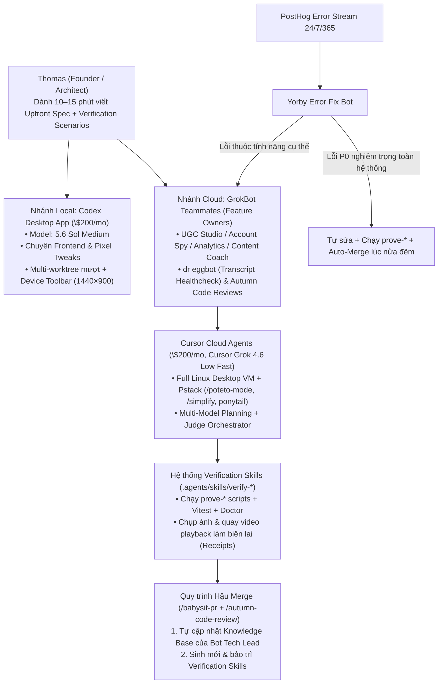

# My New AI Coding Setup That Helps Me Ship 30+ PRs A Day — Hệ Sinh Thái Dual-Driver, Pstack & GrokBot Teammates

- **Channel:** Your Average Tech Bro (Thomas Dohyun Kim — Đồng sáng lập Yorby.ai / YK Labs)
- **URL:** https://www.youtube.com/watch?v=54D1hFfaju8
- **Duration:** 20:46
- **Watch Skill ID:** `a83c842c725cd356`
- **Date Processed:** 2026-11-07
- **Tags:** #ai-agents #codex #cursor #cloud-agents #pstack #grokbot #verification-skills #posthog #yorby

---

## 1. Bối cảnh & Tóm tắt Điều hành (Executive Summary)

**Thomas Dohyun Kim** (`Your Average Tech Bro` — nhà sáng lập đã xây dựng hơn 14 ứng dụng trong 5 năm, hiện vận hành startup AI Social Media Marketing **Yorby.ai** thuộc `YK Labs` đạt doanh thu định kỳ `~$9,337–$11,400 MRR` và `Net volume $49,073.60` trên Stripe chỉ với đội ngũ siêu tinh gọn gồm 2 người) chia sẻ sự lột xác hoàn toàn trong ngăn xếp lập trình AI của mình so với 4 tháng trước.

Anh đã **ngừng sử dụng Neovim và hủy gói thuê bao Claude Code suốt 3 tháng qua**, chuyển sang mô hình **Dual-Driver trị giá \$400/tháng** kết hợp hệ thống **GrokBot Feature Owners** để xuất xưởng đều đặn **hơn 30 Pull Requests (PRs) mỗi ngày**:
1. **OpenAI Codex Desktop App (\$200/tháng — chạy `5.6 Sol Medium`):** Chuyên trị môi trường Local cho các tác vụ Frontend tinh chỉnh từng pixel, quản lý đa nhánh Git worktrees cực mượt không giật lag, tích hợp sẵn trình duyệt có **Device Toolbar** giữ nguyên khung lịch sử chat và điều khiển trực tiếp tab trình duyệt AWS Console (`YK Labs Production`).
2. **Cursor Cloud Agents + Pstack (\$200/tháng — chạy `Cursor Grok 4.6 Low Fast` sau thương vụ SpaceX AI / xAI mua lại Cursor):** Chuyên trị thực thi bất đồng bộ trên máy ảo đám mây (Full Linux Desktop VM), kết hợp bộ kỹ năng **Pstack** của Lauren Tan (`@poteto`) để lập kế hoạch đa mô hình (`Multi-Model Planning + Judge Orchestrator`) và tự động kiểm thử đầu-cuối qua hệ thống **Verification Skills** (`verify-yorby-web`, `verify-remotion-lambda`, `verify-resend`, `verify-tiktok-connect`).
3. **GrokBot Teammates (Staff Engineer / Tech Lead cho từng Module):** Thay vì dùng một phiên chat chung chung, Thomas khởi tạo một dàn bots chuyên trách từng bề mặt sản phẩm trong GrokBot (`dr eggbot`, `UGC Studio`, `Yorby Error Fix`, `Account Spy`, `Autumn Code Reviews`, `Content Calendar`, `Analytics`, `Content Coach`, `Autumn Customer Support`).
4. **Vòng lặp Hậu Merge & Trực chiến 24/7/365:** Mỗi khi merge PR, Bot sở hữu tính năng tự cập nhật Knowledge Base và viết thêm Verification Skill mới. Đặc biệt, bot `Yorby Error Fix` lắng nghe lỗi từ **PostHog** 24/7, tự động phân loại về đúng Bot chủ quản hoặc tự sửa và **Auto-merge ngay trong đêm đối với lỗi P0 diện rộng**.

---

## 2. Giải phẫu Ngăn xếp Dual-Driver (\$400/tháng): Khi Nào Dùng Codex, Khi Nào Dùng Cursor?

Thomas trả tiền túi \$200/tháng cho **Codex** và \$200/tháng cho **Cursor** (thậm chí đang cân nhắc mở lại gói đăng ký Claude khi mô hình `Fable 5.1` vừa ra mắt) với sự phân vai cực kỳ rõ ràng:

| Tiêu chí | OpenAI Codex Desktop App (\$200/tháng) | Cursor Cloud Agents (\$200/tháng) |
| :--- | :--- | :--- |
| **Mô hình hiển thị trên UI** | `5.6 Sol Medium` (`Approve for me` bật sẵn) | `Cursor Grok 4.6 Low Fast` (`Cloud` mode) |
| **Môi trường chạy** | Máy Mac cá nhân (Local Dev Environment & Local Worktrees) | Máy ảo đám mây cô lập (Dedicated Cloud Linux Desktop VM) |
| **Hiệu năng đa nhánh** | Siêu mượt khi mở nhiều Git worktrees cùng lúc | Chạy nhiều worktrees dưới local dễ bị lag; nhưng chạy trên **Cloud Agents** thì không tốn tài nguyên máy cá nhân |
| **Bài toán phù hợp nhất** | Tinh chỉnh giao diện Frontend, căn chỉnh từng pixel, thao tác nhanh với tab trình duyệt sẵn có | Xây dựng tính năng Full-stack, sửa bug phức tạp, chạy kiểm thử tự động E2E và tạo mockup phương án UI |
| **Tính năng "Ăn tiền" trên UI** | **Device Toolbar** (`Dimensions: Laptop L 1440 x 900 52%`) giữ nguyên khung lịch sử chat bên trái khi phóng to trình duyệt; công cụ **Visual Annotation** cực nhạy; điều khiển trực tiếp tab Chrome (ví dụ: tự mở AWS Console tới đúng hàm Lambda `remotion-render-4-0-519-mem2048mb-disk2048mb-120sec` tại `us-east-1` trong 1m22s) | Mỗi agent có một màn hình **Desktop VM** riêng kèm trình duyệt Chrome thật; người dùng có thể bấm `Stop Control` để nhảy vào điều khiển trực tiếp hoặc xem lại toàn bộ ảnh chụp/video quá trình agent click chuột |

---

## 3. Pstack Trên Cursor Cloud Agents: 2 Vũ Khí Thay Đổi Cuộc Chơi

Sau khi thương vụ **SpaceX AI / xAI (Grok)** mua lại **Cursor**, Thomas quay trở lại sử dụng Cursor kết hợp với bộ kỹ năng **Pstack** (`github.com/cursor/plugins/tree/main/pstack`) của **Lauren Tan (`@poteto`)** — kỹ sư đội ngũ Grok `@Bot` tại `@SpaceXAI` (tác giả chuỗi bài viết *"The Complete Guide to pstack Pt. 1 — ship 2,000 PRs a month to production"*). Khác với `GStack` của Garry Tan (Y Combinator) vốn ít tính ứng dụng thực tế, Pstack mang lại 2 bước nhảy vọt:

### 3.1. Nguyên lý 1: Multi-Model Planning + Judge Orchestrator + Cost-Effective Workers
- **Lập kế hoạch đa mô hình:** Pstack tận dụng khả năng gọi đa mô hình của Cursor để cho nhiều model khác nhau cùng khảo sát codebase và đề xuất kế hoạch triển khai tính năng.
- **Thẩm phán tổng hợp (Judge Orchestrator):** Một mô hình thông minh bậc cao đóng vai trò thẩm phán, chắt lọc những điểm xuất sắc nhất từ tất cả các bản kế hoạch riêng lẻ để tạo ra một **Master Plan** hoàn chỉnh.
- **Thực thi bằng mô hình chi phí thấp:** Sau khi đã có bản thiết kế chuẩn xác, khâu viết code thô (raw coding) không cần dùng tới các mô hình đắt đỏ như `Fable 5.1` hay `GPT 5.6 Sol Max`, mà giao cho các mô hình nhanh/rẻ như `Cursor Grok 4.6 Low Fast` thực thi với chi phí chỉ bằng một phần nhỏ nhưng chất lượng ngang ngửa frontier.

### 3.2. Nguyên lý 2: Hệ thống Verification Skills (`.agents/skills/verify-*`)
Thông qua các câu lệnh chuẩn hóa trong Cursor (như `/poteto-mode` — *"Run /poteto-mode first (bug-fix playbook). Laziness / Subtract Before Add. Smallest robust diff only"*, `/simplify` kết hợp thang `Lazy YAGNI ladder from ponytail`, `thermo-nuclear-code-quality-review`, `react-effect-guidance`, `/babysit-pr` và `/autumn-code-review`), Pstack buộc agent phải **chứng minh code hoạt động bằng biên lai thực tế (`Prove It Works`)**:
- **Cấu trúc thư mục thực tế trên repo `YK-Labs-Inc/Yorby`:**
  - `.agents/skills/verify-remotion-lambda`
  - `.agents/skills/verify-resend`
  - `.agents/skills/verify-tiktok-connect`
  - `.agents/skills/verify-yorby-web/` gồm 3 thư mục con:
    - `artifacts/`: Lưu ảnh chụp màn hình và bằng chứng kiểm thử.
    - `bin/`: Chứa các script thực thi kiểm chứng tự động (ví dụ: `prove-remix-getbyid-not-found`, `prove-facebook-page-...`, `prove-tiktok-refresh-invalid-grant`).
    - `features/`: Chứa tài liệu hướng dẫn kiểm thử từng tính năng cụ thể (`carousel-composer-models.md`, `carousel-first-create.md`, `carousel-reference-mention.md`, `creator-acquisition-funnel-an...`, `creator-onboarding-skip.md`, `creator-onboarding.md`, `creator-paywall.md`, `creator-pricing-experiment.md`, `email-otp-login.md`, `facebook-page-reconnect.md`, `landing-home.md`).
- **Ví dụ biên lai kiểm chứng thực tế trên PR `#2155`:**
  - Agent chạy `.cursor/skills/verify-yorby-web/bin/prove-remix-getbyid-not-found` ➔ Báo cáo: `PASSING REPRO (after fix) -> result: PASS`, `Test Files 1 passed (1)`, `Prove It Works. That helper ran after the fix. Doctor passed. Vitest passed.`

*(Lưu ý: Từ `05:36` đến `07:18`, video có đoạn giới thiệu nhà tài trợ **Fish Audio** và mô hình **Fish Audio S2.1 Pro** mà Yorby.ai tích hợp để lồng tiếng AI độ trễ thấp, nhân bản giọng nói và điều khiển cảm xúc trong video UGC).*

---

## 4. Tổ chức Đội ngũ "GrokBot Teammates": Mỗi Bot Làm Tech Lead Một Bề mặt Sản phẩm

Vì đội ngũ phát triển **GrokBot** tại SpaceX AI cũng chính là chủ sở hữu của **Cursor**, GrokBot có khả năng kích hoạt trực tiếp các **Cursor Cloud Agents** ngay từ giao diện chat của nó. Thomas biến GrokBot thành một phòng kỹ thuật thực thụ, nơi mỗi Bot là một **Staff Engineer / Tech Lead** chịu trách nhiệm trọn đời cho một module:

| Tên Bot trên GrokBot Sidebar | Vai trò / Bề mặt Sở hữu trong Yorby.ai | Hoạt động Thực tế Hiển thị trên Màn hình |
| :--- | :--- | :--- |
| 🔴 **`dr eggbot`** | Kiểm tra sức khỏe hệ thống & điều phối định kỳ | `transcript healthcheck (last 24h)...` (Lauren Tan vừa cập nhật thêm 2 routines mới cho Dr Eggbot) |
| 🟢 **`UGC Studio`** | Sở hữu toàn bộ **AI Content Studio** (`Hook + Demo`, `Text on Screen`, `Avatar Generation`, `Talking Head BETA`, `Carousels`) | Xử lý lỗi ẩn bộ chọn Image Model khi thu nhỏ khung chat (`PR #2150`, `+760 -77`) |
| 🟢 **`Yorby Error Fix`** | Kỹ sư trực chiến On-Call 24/7/365 kết nối **PostHog** | Tự động bắt lỗi, phân loại và sửa lỗi `PH 019fe063 TikTok refresh invalid_grant` (`PR #2158`) |
| ⚫ **`Account Spy`** | Sở hữu công cụ theo dõi tài khoản mạng xã hội của đối thủ & cảnh báo video viral | `Cursor agent: fix: PostHog scrap...` |
| 🟣 **`Autumn Code Reviews`** | Bot chuyên trách Review Code tự động & kiểm duyệt trước khi gộp nhánh | `Approved #2152 — Wire /simplify...` |
| ⚪ **`Content Calendar`** | Sở hữu tính năng lên lịch và tự động tạo nội dung chạy nền | `Messaged dr eggbot: Both knowl...` |
| 🟢 **`Analytics`** | Sở hữu hệ thống phân tích số liệu truyền thông | `Messaged dr eggbot: Both routin...` |
| 🟣 **`Content Coach`** | Sở hữu trợ lý huấn luyện nội dung & kịch bản (`Content scriptwriter`) | `Messaged dr eggbot: Both knowl...` |
| 🟣 **`Autumn Customer Support`** | Tự động hóa chăm sóc khách hàng qua Email (thay thế hoàn toàn Intercom) | `Done. Refund declined. Sub is se...` |

### Case Study Thực tế: Sửa Lỗi UI/UX Trong `UGC Studio` Không Cần Viết Code Trước (`14:16 – 14:53`)
1. **Phát hiện lỗi:** Trong tab `Carousels` của Yorby AI, khung nhập liệu ban đầu hiển thị đầy đủ cả 2 nút chọn `Chat model (Claude Sonnet 5)` và `Image model (Gemini 3.1 Flash I)` cùng công tắc `Plan mode`. Tuy nhiên, ngay khi bản nháp đầu tiên được tạo ra và khung chat co lại còn `~30%` chiều rộng ở bên trái, nút chọn `Image model` bị cắt mất do thuộc tính `overflow:hidden` của hàng footer không xuống dòng (`non-wrapping footer row`).
2. **Giao việc như nói chuyện với đồng nghiệp:** Thomas gửi vào bot `UGC Studio` 2 ảnh chụp màn hình kèm yêu cầu: *"Sử dụng poteto-mode để sửa lỗi UX trong ảnh 2... Trước tiên hãy lập kế hoạch UX bằng cách khám phá 2–3 phương án bố cục khác nhau sử dụng mô hình sinh ảnh dựa trên ảnh chụp màn hình. Sau khi tôi chọn phương án nào thì mới tiến hành viết code sản phẩm."*
3. **Bot tự tạo Gói Mockup So sánh (`Carousel V2 composer UX packet — PR #2150`):**
   - Bot chỉ ra chính xác nguyên nhân: `Cause: Shrunk chat (~30% width) + one non-wrapping footer row + overflow:hidden clips Image model (and Plan mode). Chat model stays.`
   - Tạo trang mockup trực quan đặt cạnh nhau 4 tab để Thomas chọn:
     - `Current (broken)`: Một hàng không xuống dòng làm mất nút chọn Image model.
     - `A — Wrap (rec)`: Đưa `Image model + Plan` xuống hàng thứ hai, giữ nguyên nhãn (giống mẫu của Studio Agent task-chat).
     - `B — Compact chips`: Ép tất cả trên một hàng và cắt ngắn chữ (`truncate`).
     - `C — Models popover`: Gom vào một nút bật lên (cần thêm 1 cú click và phải dùng portal thoát khỏi `overflow`).
   - Sau khi Thomas chọn phương án, bot mới viết code thật và mở PR!

### Quy trình 2 Bước Bắt buộc Sau Mỗi Lần Merge PR (`14:54 – 15:58`)
Mỗi khi một PR được merge, Thomas ra lệnh cho Bot chủ quản thực hiện đúng 2 việc:
1. **Tự cập nhật Knowledge Base:** Đọc lại các thay đổi vừa gộp vào nhánh chính để làm mới kiến thức của mình với tư cách là Staff Engineer/Tech Lead của tính năng đó.
2. **Tạo mới hoặc cập nhật Verification Skills:** Ghi lại quy trình kiểm thử bề mặt vừa thay đổi vào `.agents/skills/verify-*` để mọi agent sau này đều biết cách tự kiểm tra không gây lỗi hồi quy.
- *Hướng mở rộng tiếp theo:* Khi làm tính năng liên phòng ban (chạm cả `Analytics` lẫn `UGC Studio`), Thomas có thể **tạo một Group Chat trong GrokBot** gom cả 2 Bot Tech Lead vào cùng một phòng để chúng tự thảo luận, phản biện chéo và thống nhất thiết kế.

---

## 5. Vận hành Startup Tự động 24/7: Thay thế Intercom & Bot Trực Lỗi PostHog Tự Merge Lúc Nửa Đêm

### 5.1. `Autumn Customer Support` — Xóa sổ Intercom bằng Email Agent Tự Học (`17:52 – 18:34`)
- Yorby.ai đã bỏ hẳn Intercom để chuyển về dùng email thuần túy kết nối với bot `Autumn Customer Support`.
- Bot liên tục theo dõi hòm thư hỗ trợ và tự giải quyết các kịch bản đã có trong chỉ dẫn (ví dụ: xử lý yêu cầu hoàn tiền và kiểm tra trạng thái gói thuê bao).
- Nếu gặp tình huống mới chưa có trong tài liệu, bot sẽ gắn thẻ gọi Thomas và đồng sáng lập vào xử lý; ngay sau khi con người giải quyết xong, giải pháp đó được tự động đúc kết và cập nhật ngược vào bộ chỉ dẫn của bot để lần sau tự xử lý 100%.

### 5.2. `Yorby Error Fix` — Kỹ sư On-Call 24/7/365 & Quyền Auto-Merge Lỗi P0 (`18:35 – 20:12`)
- **Luồng hoạt động:** Mọi lỗi phát sinh trên môi trường production được **PostHog** thu thập và đẩy thẳng vào bot `Yorby Error Fix`.
- **Phân loại thông minh (Triage & Route):**
  - Nếu lỗi nằm ở một bề mặt cụ thể (`UGC Studio`, `Account Spy`, `Content Calendar`, `Analytics`, `Content Coach`), nó đóng gói toàn bộ ngữ cảnh và chuyển tiếp cho Bot Tech Lead sở hữu bề mặt đó sửa.
  - Nếu lỗi chung chung không thuộc riêng bot nào, chính `Yorby Error Fix` sẽ đóng vai trò `miscellaneous bug fixer`, tự khởi chạy Cursor Cloud Agent để sửa và đính kèm báo cáo 3 phần rõ ràng:
    - *Ví dụ thực tế trên màn hình (`PH 019fe063 TikTok refresh invalid_grant — PR #2158`):*
      1. **Original bug:** TikTok refresh trả về HTTP 200 kèm `invalid_grant` trong khi `refresh_token_expires_at` vẫn ở tương lai ➔ báo lỗi `No access_token in TikTok response` và mở tới 2 issue PostHog mỗi ngày.
      2. **How the fix works:** Hàm `classifyTikTokTokenRefreshResponse` coi `invalid_grant (200/400)` là `expired_grant`: chỉ ghi cảnh báo (`warn`), đặt `refresh_token_expires_at` về thời điểm hiện tại và trả về `skipped` để cron job bỏ qua hàng đó mà không xóa trắng token.
      3. **Proof:** Chạy `prove-tiktok-refresh-invalid-grant` — toàn bộ Vitest classify + warn/skip pins đều PASS!
- **Đặc quyền Auto-Merge cho sự cố P0 lúc nửa đêm:** Thông thường bot chỉ tạo PR chờ duyệt, nhưng Thomas đã cài đặt một điều khoản đặc biệt trong prompt: nếu phát hiện lỗi **cực kỳ khẩn cấp (`P00 / widespread bug`) ảnh hưởng tới toàn bộ hoặc đại đa số người dùng** ngay giữa đêm khuya, bot được **toàn quyền tự động merge PR lên production mà không cần chờ con người phê duyệt** — sự tự tin này hoàn toàn được xây dựng trên nền tảng các bộ **Verification Skills** nghiêm ngặt của dự án.

---

## 6. Triết lý "Upfront Engineering" — Dành 15 Phút Viết Spec Để One-Shot Toàn Bộ Quy Trình

Thomas đúc kết rằng để bước lên ngưỡng **10x AI Engineer**, lập trình viên phải dám **buông bỏ thói quen đọc từng dòng code (`let go of reading all the code`)** và chuyển toàn bộ năng lượng kỹ thuật lên giai đoạn **đầu vào (Upfront Engineering)**:
- Thay vì gõ một câu lệnh cụt lủn 30 giây rồi tốn hàng giờ tự click chuột kiểm tra, anh dành **10 đến 15 phút** để viết một bản đặc tả (prompt/ticket) chi tiết như thể đang giao việc cho một kỹ sư Junior:
  1. Chỉ định rõ những gì cần thay đổi và những bề mặt (`surfaces`) nào được phép chạm vào.
  2. Liệt kê danh sách các kịch bản xác minh (`verification scenarios`) bắt buộc phải vượt qua.
  3. Liệt kê các kịch bản kiểm tra hồi quy (`regression scenarios`) để đảm bảo không làm hỏng tính năng cũ.
  4. Đính kèm tài liệu tham khảo và ảnh chụp màn hình.
- Khi đầu vào đủ chặt chẽ kết hợp cùng Pstack và Verification Skills, Cloud Agent sẽ tự động chạy một mạch (one-shot), tự kiểm thử trên máy ảo, tự nhờ `Autumn Code Reviews` duyệt code và chỉ để lại cho con người quyết định phê duyệt cuối cùng trong vài giây.
