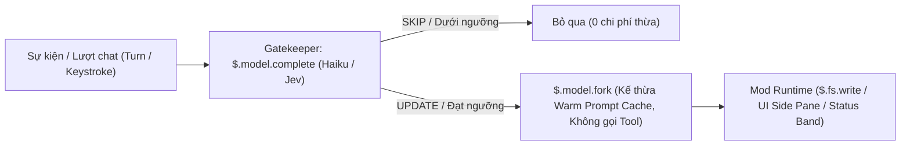

# The S TIER Claude Code Mods — 8 Bản Độ Claude Code Đỉnh Cao Từ Ray Amjad

- **Channel:** Ray Amjad
- **URL:** https://www.youtube.com/watch?v=Od9706XIXcc
- **Duration:** 19:00
- **Watch Skill ID:** `6627ec39958eec10`
- **Date Processed:** 2026-11-07
- **Tags:** #ai-agents #claude-code #claude-code-mods #ray-amjad #memory-fork #dream-pass #impello #agent-swarms #jev #prompt-bouncer

---

## 1. Tổng quan & Bối cảnh

Sau khi Anthropic chính thức công bố tính năng **Claude Code Mods** (`@ClaudeDevs`, ngày 02/10/2026 — cho phép tùy biến hành vi, giao diện side-pane/status-band và tích hợp tính năng riêng qua `/plugin`), **Ray Amjad** đã xây dựng và mã nguồn mở 8 bản mod thực chiến giúp nâng cấp toàn diện trải nghiệm kỹ nghệ Agentic trên Claude Code (`v2.1.296`, chạy `Opus 5.5 - Claude Max` trên Kitty terminal).

Thay vì dùng Subagents truyền thống (vốn tốn thời gian khởi tạo, dễ vướng bộ phân loại quyền trong Auto Mode và có TTL cache ngắn), kiến trúc cốt lõi của chuỗi mod này xoay quanh sự kết hợp giữa **2 nguyên hàm (primitives)** trong SDK của Claude Code Mods:
1. **`$.model.complete` (Gatekeeper siêu nhẹ):** Gọi model nhỏ/nhanh như **Claude Haiku** (`maxTokens: 60`, trả về `YES/NO` hoặc `UPDATE/SKIP`) hoặc bộ phân loại **TypeSafe Jev** để chấm điểm xác suất ngay lập tức với chi phí gần như bằng 0.
2. **`$.model.fork` (Tool-less Session Clone):** Nhân bản phiên làm việc hiện tại để **tận dụng trực tiếp Prompt Cache đang ấm (warm prompt cache)** của phiên chính kèm theo một chỉ thị bổ sung, trả về kết quả JSON/text thuần túy mà không gọi công cụ (tool-less), sau đó chính code của Mod (`$.fs.write`) sẽ ghi file xuống đĩa — qua đó **bỏ qua hoàn toàn mọi lời nhắc xin quyền (permission prompts)** ở mọi chế độ!

---

## 2. Phân tích Chi tiết 8 Bản Mod S-Tier

### 2.1. Mod #1: `ray-amjad/memory-fork` — Ghi nhớ Tự động Không Cần Xin Quyền (`00:40 – 03:54`)
- **Lệnh cài đặt:** `/plugin install memory-fork --marketplace ray-amjad/memory-fork`
- **Vấn đề của Auto-Memory mặc định & Subagent:**
  - Nếu đợi cuối phiên mới lưu bộ nhớ hoặc giao cho Claude chính vừa làm việc vừa ghi chú thì dễ bị sót thông tin hoặc làm loãng ngữ cảnh.
  - Phiên bản đầu tiên của Ray spawn một forked subagent để ghi file, nhưng trong **Auto Mode**, mọi lệnh spawn agent đều phải đi qua *permission classifier*; vì người dùng không trực tiếp gõ lệnh spawn đó nên classifier từ chối cấp quyền và làm tác vụ thất bại.
- **Cách hoạt động (`memory-fork/hooks/register.tsx`):**
  1. Ở mỗi lượt hội thoại (`turn`), mod gửi chỉ mục bộ nhớ hiện tại (`<memory_index>`) và nội dung lượt chat (`<turn>`) qua `$.model.complete({ model: 'haiku', system: JUDGE, maxTokens: 60 })`.
  2. Nếu Haiku trả về dòng bắt đầu bằng `UPDATE`, mod gọi `$.model.fork({ prompt: writerPrompt(reason, await readMemory($, dir)) })`.
  3. Bản fork đọc toàn bộ ngữ cảnh phiên chính, xuất nội dung markdown cần cập nhật, và code của mod tự ghi vào đĩa qua `$.fs.write`.
- **Demo thực tế:** Khi Ray gõ vào dự án `~/Desktop/impello`: *"Hey, so remember that I want the ClickHouse P99 latency to be under 50 milliseconds?"*, thanh trạng thái phía trên ô nhập liệu hiện ngay `Memory: updating (ClickHouse P99 query latency target under 50 ms) [ Open ] [ Hide ] [-]` và khung bên phải ghi log: `10:11 fork writing: ClickHouse P99 query latency target under 50 ms, set by Ray; which path (dashboard queries or build-1 inserts) still unconfirmed.`

### 2.2. Mod #2: `ray-amjad/diagram-pane` — Bản đồ Kiến trúc & Luồng Thay đổi Trực quan (`03:54 – 06:15`)
- **Cơ chế:** Sau các lượt làm việc dài (ví dụ khi Claude vừa xây dựng mod `jev-skill-suggester`, chạy thử nghiệm trên `herdr` và đẩy lên GitHub), Haiku kiểm tra xem có thay đổi kiến trúc đáng kể nào không. Nếu có, một bản fork sẽ vẽ sơ đồ ASCII/Box-drawing trực tiếp vào **Side Pane** bên phải.
- **Hệ thống ký hiệu trực quan (Legend ở đáy Pane):**
  - `┌ file` (khung góc vuông): Tệp tin mã nguồn (ví dụ `hooks/register.tsx`, `hooks/jev.ts`).
  - `╭ component` (khung bo tròn): Thành phần hệ thống / API (ví dụ `TypeSafe Jev API`, `band + /jev pane`).
  - `╔ step` (khung viền kép): Bước thực thi quan trọng trong phiên (`live test in herdr`, `gh repo create`).
  - `▶ now`: Đánh dấu vị trí hiện tại của phiên (`map drawn at turn 7`).
- **Tự động ghim Mermaid Diagram:** Nếu người dùng yêu cầu Claude vẽ sơ đồ Mermaid ngay trong khung chat (nơi terminal không thể render đồ họa), `diagram-pane` tự động bắt lấy khối Mermaid đó và ghim (`pinned`) sang thanh bên phải để xem và thu phóng dễ dàng.

### 2.3. Mod #3: `ray-amjad/dream-pass` — Dọn dẹp & Hợp nhất Bộ nhớ Trước Khi Compaction (`06:15 – 07:05`)
- **Cảm hứng:** Lấy cảm hứng từ tính năng **Dreaming** của **Cognition (Devin)** (công bố ngày 06/10/2026 kèm chuẩn mã nguồn mở `cognition.com/agent-memory-repo` — nơi Devin tự cải thiện bộ nhớ vào ban đêm để xóa bản ghi cũ và phát hiện thông tin tiềm ẩn).
- **Quy trình 4 bước (4-Step Pipeline):**
  1. **TRIGGER:** Kích hoạt tự động sau mỗi **20 turns**, **ngay trước khi nén ngữ cảnh (just before compaction)**, hoặc gọi thủ công bằng lệnh `/dream`.
  2. **GATE (Code, sau đó là Haiku):** Kiểm tra chỉ mục miễn phí bằng code trước, rồi hỏi Haiku `YES/NO` xem bộ nhớ có bị trùng lặp/lỗi thời không.
  3. **FORK DECIDES:** Fork phiên làm việc (có đầy đủ ngữ cảnh, không dùng tool) và trả về JSON `{merged, rewritten, removed, index}` kèm liên kết `sources` trỏ tới phiên gốc.
  4. **MOD APPLIES:** Tự động sao lưu vào `.dream-backup/` trước, sau đó dùng `$.fs.write` và `rm` để cập nhật bộ nhớ.
- **Demo trên repo `~/code/tidepool`:** Thu gọn từ `13 → 9 memories` (`3 merged · 1 removed · 1 rewritten`), ví dụ cập nhật `project_deploy_heroku.md` thành *"Hosting moved from Heroku to Fly.io"*, xóa `project_launch_2026_03.md`, kèm nút `[ Open ] [ Undo ] [ Hide ]`.

### 2.4. Mod #4: `impello-swarm` (`/swarm`) — Bảng Điều khiển Đàn 100 Agents & Message Board (`07:05 – 12:05`)
- **Bối cảnh & Hạ tầng Impello (`impello.ai`):**
  - Cũng từ bài viết về `Agent Memory Repo` của Cognition, Ray chú ý tới mô hình **Agent Swarm giao tiếp qua Message Board** (nhiều agent cùng đọc/ghi vào bảng tin chung để giải quyết bài toán hiệu năng).
  - Để chạy hàng trăm agent song song với chi phí rẻ, Ray ra mắt nền tảng cloud sandbox **Impello (`impello.ai`)** — cung cấp máy ảo Linux cô lập khởi tạo từ `Dockerfile`, tạm dừng miễn phí (`pause for free`), chạy tại cụm máy chủ EU với chi phí **rẻ hơn từ 8 đến 40 lần** so với các nhà cung cấp khác (ví dụ: 8 sandboxes / 18 vCPU chỉ tốn `~$0.16/h`, và khi mở rộng lên **100 agents / 206 vCPU chạy song song chỉ tốn `~$1.85/h`**).
- **Tính năng của `/swarm` Pane (`impello-swarm`):**
  - Cho phép chuyển đổi linh hoạt giữa tab `Swarm` và `Diagrams` ngay ở khung bên phải của Claude Code.
  - Hiển thị trạng thái thời gian thực của **Percy board**: tổng số tin nhắn, số tin nhắn trực tiếp (DMs), số lượng agent đang thảo luận và tự động gom nhóm các cặp agent tương tác nhiều thành **Clusters** (ví dụ: `485 msgs · 162 DMs · 60/103 talking · 17 clusters` như `PP-DDIA`, `DDIA-DDD`, `WELC-MMM`, `GOF`).
  - Theo dõi chi tiết từng sandbox (`percy-5`, `percy-5-large`), mức sử dụng CPU/RAM và trạng thái đọc/ghi (`R read`, `W write`, `$ running`, `red failed`).
- **Thí nghiệm thực tế (`swe-books-swarm`):** Ray giao cho đàn **100 agents** kiểm chứng thực nghiệm **25 cuốn sách Kỹ thuật Phần mềm kinh điển** (như *Refactoring* của Martin Fowler, *Designing Data-Intensive Applications*, *Domain-Driven Design*, *Working Effectively with Legacy Code*, *Gang of Four*) thông qua quy trình tạo giả thuyết, chạy benchmark có kiểm chứng mù (blind review `A=principle | B=control`) và chấm điểm `[VERDICT]: USE / ADAPT / HUMAN-ONLY / DROP` để tìm ra những nguyên lý thiết kế phần mềm nào thực sự hiệu quả cho AI Agents.

### 2.5. Mod #5: `ray-amjad/decision-tree` — Phân nhánh & Khám phá Quyết định Kiến trúc (`12:05 – 13:38`)
- **Vấn đề:** Khi Claude hỏi người dùng lựa chọn giữa nhiều phương án kỹ thuật (ví dụ: chọn cơ chế lưu trữ cho Notes API: `1. JSON file`, `2. SQLite`, `3. Hosted Postgres`), người dùng thường phải hỏi đi hỏi lại trong phiên chính làm bẩn ngữ cảnh.
- **Cách hoạt động (`/explain`):**
  - Vô hiệu hóa công cụ `AskUserQuestion` mặc định và mở khung **Decision tree** ở bên phải.
  - Cho phép nhấn `[ Explore ]` vào bất kỳ phương án nào (hoặc tự nhập phương án riêng như `D: use Redis`) để **fork phiên làm việc trong nền (`branch session`)**.
  - Trong mỗi nhánh con, bạn có thể tiếp tục đào sâu các câu hỏi tiếp theo (ví dụ chọn `B: SQLite` ➔ hỏi tiếp *"Which SQLite driver?"* ➔ `A: better-sqlite3` vs `B: node:sqlite`), xem bản đồ tổng thể qua nút `[ Map ]` (đánh dấu `* recommended`, `▸ explored`, `✎ yours`), và khi chốt được phương án tối ưu mới đẩy quyết định cuối cùng về phiên chính!

### 2.6. Mod #6: `ray-amjad/cache-clock` — Đồng hồ Đếm ngược Prompt Cache & Auto-Handoff (`13:38 – 14:17`)
- **Cơ chế TTL của Prompt Cache trên Claude Code:** Theo xác nhận từ kỹ sư Anthropic **Lydia Hallie (`@lydiahallie`)**, thời gian sống (TTL) của Prompt Cache là **1 giờ (60 phút) đối với gói thuê bao (Subscription) ở phiên chính**, và **5 phút đối với Subagents hoặc API billing** (có thể chỉnh qua `promptCacheTtl` / `subagentPromptCacheTtl` trong `settings.json`).
- **Tính năng của `cache-clock`:**
  - Hiển thị thanh trạng thái phía trên ô nhập liệu cho biết phần trăm ngữ cảnh đã dùng và đồng hồ đếm ngược thời gian còn lại trước khi Prompt Cache bị lạnh (cold).
  - **Auto-Handoff (`CACHE_CLOCK_AUTO_HANDOFF=on`):** Khi thời gian cache còn dưới ngưỡng cảnh báo (`CACHE_CLOCK_WARN_MIN`, mặc định `5` phút), thanh trạng thái chuyển sang màu đỏ, phát âm thanh cảnh báo (`sounds/cooling.wav` nếu bật `CACHE_CLOCK_SOUND=1`) và **tự động kích hoạt một bản fork để viết tài liệu bàn giao (`handoff.md`)** trước khi cache hết hạn — giúp bạn tiết kiệm hàng chục nghìn token khi quay lại làm việc sau nhiều giờ!

| Biến môi trường (`cache-clock`) | Mặc định | Chức năng |
| :--- | :---: | :--- |
| `CACHE_CLOCK_MAIN_TTL_MIN` | `60` | Thời gian sống (phút) của Prompt Cache phiên chính |
| `CACHE_CLOCK_SUB_TTL_MIN` | `5` | Thời gian sống (phút) của Prompt Cache cho Subagents |
| `CACHE_CLOCK_WARN_MIN` | `5` | Ngưỡng cảnh báo đỏ, hiện toast và kích hoạt Auto-Handoff |
| `CACHE_CLOCK_AUTO_HANDOFF` | `on` | Tự động tạo file handoff khi cache sắp hết hạn (`0` để tắt) |
| `CACHE_CLOCK_SOUND` | `off` | Đặt bằng `1` để phát âm thanh `sounds/cooling.wav` khi cảnh báo |

### 2.7. Mod #7: `ray-amjad/jev-skill-suggestion` — Định tuyến Skill Thời gian Thực bằng TypeSafe Jev (`14:17 – 15:42`)
- **Vấn đề:** Khi cài đặt quá nhiều Skills (ví dụ Ray cài tới 48–84 skills), chỉ riêng tên và phần mô tả (`description`) của chúng đã ngốn mất **~10.000 tokens** cố định trong cửa sổ ngữ cảnh của mọi phiên làm việc, đồng thời khiến Claude dễ chọn nhầm skill.
- **Cách hoạt động (`/jev steer`):**
  - Tích hợp bộ phân loại siêu tốc **TypeSafe Jev** để chấm điểm nháp câu lệnh của bạn **ngay khi bạn đang gõ** (500ms sau khi ngừng gõ, trước cả khi nhấn Enter).
  - **Quy trình 4 bước:**
    1. *You Type (Scored live):* Gửi bản nháp tới Jev sau 500ms ngừng gõ.
    2. *Jev Ranks All (One Choice, 3 Nouls):* Chấm điểm toàn bộ danh sách skill cùng cổng kiểm tra `gate` (*"Câu lệnh này có cần dùng skill không?"* — nếu `gate < 0.30` thì không nạp skill nào).
    3. *Jev Re-reads Top 3 (`SKILL.md`):* Đọc 700 ký tự đầu tiên trong `SKILL.md` của 3 skill điểm cao nhất để tính điểm `fits`.
    4. *Chế độ điều khiển (`observe` / `block` / `steer`):* Ở chế độ `steer`, mod chặn Claude tự ý nạp toàn bộ danh sách skill và chỉ nạp duy nhất skill (hoặc Top 3 skills) do Jev chọn (ví dụ: gõ `"commit all of this in separate commits and push it"` ➔ `Jev steer · gate 0.82 · loads commit-sweep · 412ms`, điểm `0.99 commit-sweep fits 0.94`).

### 2.8. Mod #8: `ray-amjad/secret-box` & `ray-amjad/prompt-bouncer` — Bảo mật Khóa API & Chặn Prompt Mơ hồ (`15:42 – 18:59`)
1. **`ray-amjad/secret-box` (Quản lý biến môi trường kiểu Agent Proxy):**
   - Đăng ký công cụ `request_secret` vào Claude Code. Khi Claude cần một API key (cho tác vụ GTM, marketing, Slack, GitHub...), một bảng nhập liệu bảo mật hiện ra ở khung bên phải để người dùng lưu khóa vào thư mục `.env` cục bộ mà **Claude bị chặn quyền đọc trực tiếp**.
   - Hoạt động tương tự cơ chế **Agent Proxy của Infisical**: Claude chỉ nhìn thấy và sử dụng một mã định danh đã che (`redacted placeholder ID`) trong suốt phiên làm việc; khi gửi HTTP request ra ngoài, lớp mod/proxy sẽ tự động tráo mã giả này bằng khóa thật (lấy từ `.env` hoặc Infisical Cloud). Nhờ vậy, khóa bí mật **không bao giờ xuất hiện trong lịch sử phiên (session transcript) hay gửi lên máy chủ của nhà cung cấp LLM**.
2. **`ray-amjad/prompt-bouncer` (Người gác cổng Haiku chặn Prompt cẩu thả):**
   - Khi lập trình viên mệt mỏi và gõ những câu lệnh mơ hồ như `"fix the thing on the settings page"`, Haiku Bouncer sẽ lập tức **từ chối lượt chat (`REJECTED — turn aborted, 0 tokens spent`)** trước khi gửi tới Opus 5.5.
   - **Tích hợp Từ điển Dự án (Project Glossary):** Nếu dự án quy ước gọi trang thanh toán là `Billing Panel` nhưng bạn lại gõ `"The payments page shows a wrong price. Fix it."`, `prompt-bouncer` sẽ bật lại thông báo: *"Bounced. This project calls it the Billing Panel — which one?"*. Dù hơi khắt khe lúc đầu, bản mod này rèn luyện thói quen viết prompt chính xác theo đúng thuật ngữ miền (domain terminology) của dự án và tiết kiệm lượng lớn token về lâu dài.

---

## 3. Tổng kết & Bài học Rút ra cho Hệ thống Agentic

1. **Mô hình "Haiku Gate + Warm-Cache Model Fork" là mẫu thiết kế vàng cho Claude Code Mods:** Luôn đặt một bộ lọc siêu rẻ (`Haiku` hoặc `Jev`) ở đầu phễu; chỉ khi cần thiết mới gọi `$.model.fork` (không dùng tool) để tận dụng 100% ngữ cảnh đang nằm sẵn trong Prompt Cache của phiên chính mà không làm gián đoạn luồng làm việc hay vướng quyền thực thi.
2. **Đưa Quan sát (Observability) vào Side Pane:** Khi thời gian chạy của một lượt agent kéo dài hàng giờ hoặc tỏa ra (fan-out) thành đàn 100 agents trên cloud sandbox, việc có các bảng điều khiển chuyên biệt (`diagram-pane`, `impello-swarm`, `decision-tree`, `cache-clock`) ngay trong terminal giúp kỹ sư giữ vững quyền kiểm soát (human-in-the-loop) mà không bị ngập trong log văn bản.
3. **Bảo vệ Ngữ cảnh & Ngân sách Token từ Gốc:** Kết hợp `cache-clock` (tự động viết handoff trước khi hết hạn cache 60 phút), `jev-skill-suggestion` (cắt giảm 10.000 tokens mô tả skill thừa) và `prompt-bouncer` (chặn prompt mơ hồ ngay từ cửa) giúp tối ưu hóa triệt để cả chi phí lẫn độ chính xác của mô hình lớn.
