# 🌳 The Best Git Worktree Tool I've Used: Worktrunk (`wt`) — Better Stack

## 📋 Metadata
- **Video Title:** The Best Git Worktree Tool I've Used (Worktrunk)
- **Channel / Creator:** Better Stack (Presented by Josh)
- **URL:** https://www.youtube.com/watch?v=mNo24Omj8X4
- **Duration:** 07:13
- **Watch Skill ID:** `1c7210ab1589417b`
- **Frames Inspected:** 50 frames (`frame_0000.jpg` – `frame_0049.jpg` in `C:\Users\Admin\.watch-skill\frames\1c7210ab1589417b\`)
- **Date Processed:** 2026-11-07
- **Topic:** Git Worktree CLI for Parallel AI Coding Agents (`max-sixty/worktrunk`), Copy-on-Write (`wt step copy-ignored`), `hash_port` Filter, and 6-in-1 `wt merge`

---

## 🎯 Tóm tắt cốt lõi (Executive Summary)

Josh từ **Better Stack** phân tích tại sao tính năng worktree tích hợp sẵn của Claude Code (`claude --worktree`) mới chỉ giải quyết được **một nửa bài toán** (tạo và tự dọn dẹp), nhưng lại bỏ qua nửa đau đớn nhất khi chạy 3–10+ AI agents song song: **không có lệnh gộp (merge) kết quả về nhánh chính, không có màn hình tổng quan theo dõi trạng thái mọi agents, và bắt cài lại dependencies từ đầu (cold start)**.

**Worktrunk (`wt`)** (`github.com/max-sixty/worktrunk` / `worktrunk.dev`, viết bằng **Rust**, giấy phép **MIT / Apache-2.0**, ~3.6k+ stars, phát hành bản mới ~3 lần/tuần) giải quyết triệt để các điểm nghẽn này:
1. **Tư duy theo Nhánh thay vì Thư mục (`Branch-First UX`):** Thay vì phải gõ tên nhánh 3 lần (`git worktree add -b feat ../repo.feat && cd ../repo.feat`), bạn chỉ cần gõ 1 dòng `wt switch -c claude feature-a` để vừa tạo nhánh, vừa tạo thư mục theo template, vừa nhảy vào thư mục đó và khởi chạy luôn Claude Code.
2. **Màn hình Giám sát Bầy đàn (`wt list`):** Hiển thị toàn bộ worktrees trên một bảng duy nhất kèm trạng thái diff (`HEAD±`, `main↕`, `main…±`), trạng thái CI và biểu tượng trực quan: 🤖 (Agent đang làm việc) hoặc 💬 (Agent đang đợi phản hồi của bạn).
3. **Vũ khí sát thủ `wt step copy-ignored` (Copy-on-Write / Reflink):** Một worktree mới không có `node_modules/`, `target/` hay `.env`. Thay vì copy 14GB thư mục `target/` của Rust mất **2 phút + tốn thêm 14GB ổ cứng**, `wt step copy-ignored` dùng cơ chế **Copy-on-Write (reflink)** trên APFS (macOS), btrfs/XFS (Linux), ReFS (Windows) chỉ mất **20 giây và tốn ~0 GB ổ cứng**, kéo thời gian build Rust lần đầu từ **68 giây xuống còn 3–4 giây**!
4. **Bộ lọc `hash_port` & Lệnh Gộp 6-trong-1 (`wt merge`):** Cấp tự động mỗi worktree một port dev server riêng (`PORT={{ branch | hash_port }}`) để 3 agents không tranh giành cổng `3000`. Khi agent làm xong, một lệnh `wt merge` duy nhất thực hiện trọn gói 6 bước: `commit` → `squash` → `rebase onto main` → `fast-forward main` → `delete worktree` → `delete branch`.

---

## 🏗️ Kiến trúc Luồng Công việc Song song với Worktrunk (`wt`)

```mermaid
flowchart LR
    subgraph MainRepo["📦 Main Checkout (main)"]
        BaseCache["🗂️ Gitignored Cache<br/>node_modules/ | target/ (14GB) | .env"]
    end

    subgraph ParallelWorktrees["🚀 Parallel Agent Worktrees (via 'wt switch')"]
        direction TB
        WT_A["🌿 feature-a (Port: hash_port)<br/>🤖 Claude Code Working<br/>HEAD: +1K -74"]
        WT_B["🌿 feature-b (Port: hash_port)<br/>💬 Waiting on User<br/>HEAD: +15 -1"]
        WT_C["🌿 feature-c (Port: hash_port)<br/>🤖 Codex / Gemini CLI<br/>HEAD: +1K -6"]
    end

    subgraph MergePipeline["🔄 'wt merge' (6 Git Commands in 1)"]
        direction LR
        M1["1. Commit"] --> M2["2. Squash"] --> M3["3. Rebase onto main"] --> M4["4. Fast-forward"] --> M5["5. Remove worktree & branch"]
    end

    BaseCache ==>|"wt step copy-ignored<br/>Copy-on-Write Reflink (20s, ~0GB)"| ParallelWorktrees
    ParallelWorktrees -->|"wt list (Single Status View)"| MergePipeline
    MergePipeline --> MainRepo
```



---

## ⏱️ Phân tích chi tiết theo dòng thời gian & Visual Frames

### 1. Tại sao `git worktree` thuần và `claude --worktree` vẫn chưa đủ? (`00:00` – `01:26` | `frame_0000` – `frame_0019`)
- **Xung đột khi chạy chung 1 thư mục (`frame_0014`):** Khi `Agent A` và `Agent B` cùng sửa `repo/src/api.ts` và chạy `src/api.test.ts` trên một thư mục duy nhất, `Agent A` đang refactor dở sẽ làm test của `Agent B` nổ tung — giống như hai người cố viết lên cùng một tờ giấy.
- **Nỗi khổ của `git worktree` gốc (`frame_0016`):**
  - Để tạo một worktree mới, bạn phải gõ tên nhánh tới 3 lần:
    ```bash
    git worktree add -b feat ../repo.feat && cd ../repo.feat
    ```
  - Khi dọn dẹp lại tốn thêm 3 lệnh nữa, và `git worktree list` chỉ trả về một danh sách đường dẫn thư mục khô khan.
- **Hạn chế của `claude --worktree` tích hợp sẵn (`frame_0003`, `frame_0009`, `frame_0019`):**
  - Dù đã tự động hóa bước **1. Create** và **2. Clean up** (`frame_0009`), nó vẫn thiếu 2 mảnh ghép sống còn (`frame_0019`):
    - ❌ **Merge back:** Không có lệnh đưa code đã hoàn thành về lại nhánh `main`.
    - ❌ **One view of every agent:** Không có bảng điều khiển chung để biết agent nào đang chạy, agent nào đang chờ mình.
    - Về phần cài đặt thư viện (`dependencies`), tài liệu chính thức chỉ bảo: *"Hãy nhắc Claude tự chạy lệnh cài đặt"*.

---

### 2. Thực chiến Chạy 3 Agents Song song & Bảng điều khiển `wt list` (`01:27` – `03:23` | `frame_0020` – `frame_0024`)
- **Khởi chạy 3 Agents trên 3 Nhánh bằng 1 dòng lệnh duy nhất (`01:32` – `02:18`):**
  - Mở 3 khung terminal, trong mỗi khung chỉ cần chạy 1 lệnh `wt switch` để tạo worktree cho `feature-a`, `feature-b`, `feature-c` và kích hoạt thẳng Claude Code.
  - Ba thư mục hoàn toàn tách biệt được sinh ra tự động (`~/Desktop/taskflow-api.feature-a`, `.feature-b`, `.feature-c` - `frame_0023`, `frame_0024`).
- **Bảng tổng quan `wt list` (`frame_0007`, `frame_0020`, `frame_0023`, `frame_0024`):**
  - Chạy `wt list` (hoặc `wt list --full` để xem cả trạng thái CI PR) hiển thị toàn bộ bức tranh trên một màn hình:
    ```text
    Branch      Status   HEAD±       main↕   main…±     Remotes  Commit   Age  Message
    @ main          ^|                                           6d24512  20m  main commit
    + feature-a !?  ~    +1K   -74                               6d24512  20m  main commit
    + feature-b !   ~    +15   -1                                6d24512  20m  main commit
    + feature-c !?  ~    +1K   -6                                6d24512  20m  main commit
    ```
  - **Các ký hiệu trực quan của Agent:**
    - Biểu tượng **Robot (🤖):** Agent trong worktree đó đang tích cực chạy tác vụ.
    - Biểu tượng **Bong bóng thoại (💬):** Agent đang dừng lại chờ quyết định từ người dùng.
  - Chuyển đổi tức thì giữa các worktrees mà không cần nhớ đường dẫn thư mục bằng lệnh:
    ```bash
    wt switch feature-a
    ```

---

### 3. Cơ chế Hoạt động Ngầm: Shell Wrapper & Hook Đa Agent CLI (`03:24` – `04:16` | `frame_0025` – `frame_0033`)
- **Tại sao bắt buộc phải chạy `wt config shell install`? (`frame_0028` – `frame_0030`):**
  - Trong hệ điều hành Unix/Windows, một tiến trình con (như binary `wt`) **không thể tự thay đổi thư mục hiện hành (`cd`) của tiến trình shell cha**.
  - Khi gõ `which wt` (`frame_0029`, `frame_0030`), ta thấy `wt config shell install` cài một hàm wrapper siêu nhỏ vào shell:
    ```zsh
    wt () {
      cd_file="$(mktemp)"
      {
        WORKTRUNK_DIRECTIVE_CD_FILE="$cd_file" command "${execution[@]}"
      } always {
        if [[ -s "$cd_file" ]]
        then
          builtin cd -- "$(<"$cd_file")"
        fi
      }
    }
    ```
  - Nếu bỏ qua bước `wt config shell install`, mọi lệnh tạo nhánh vẫn chạy nhưng thao tác nhảy thư mục (`cd`) sẽ âm thầm không xảy ra!
- **Tích hợp trực tiếp vào Hook `WorktreeCreate` của 6 Agent CLIs (`frame_0032`, `frame_0033`):**
  - Worktrunk không hề xung đột với tính năng worktree sẵn có của Claude Code mà móc thẳng vào **`WorktreeCreate` hook** (`frame_0032`) — nghĩa là ngay cả khi Claude Code tự tạo worktree, nó cũng đi qua pipeline của Worktrunk.
  - Hỗ trợ chính thức **6 Agent CLIs** (`frame_0033`):
    1. **Claude Code**
    2. **Codex**
    3. **OpenCode**
    4. **Pi**
    5. **oh-my-pi (`omp`)**
    6. **Gemini CLI**

---

### 4. Ba Tính năng Sát thủ: `wt step copy-ignored` (CoW), `hash_port` & `wt merge` (`04:17` – `05:27` | `frame_0034` – `frame_0042`)
- **1. Xóa sổ Cold Start bằng `wt step copy-ignored` (`frame_0035` – `frame_0040`):**
  - **Vấn đề (`frame_0036`):** Một worktree mới chỉ có mã nguồn (`your code`), nhưng mất sạch các tệp nằm trong `.gitignore`: ❌ `node_modules/`, ❌ `target/` (build cache), ❌ `.env`. Chạy 5 agents là phải trả giá cài đặt và biên dịch lại từ đầu 5 lần.
  - **Giải pháp Copy-on-Write (`frame_0037`, `frame_0038`):** Lệnh `wt step copy-ignored` nhân bản các thư mục `.gitignore` từ nhánh chính sang worktree mới bằng cơ chế **Copy-on-Write (reflink)** — cả `main/target/` và `feature-a/target/` cùng trỏ vào một khối dữ liệu vật lý trên ổ đĩa (`disk blocks`) cho đến khi có file bị ghi đè.
  - **Benchmark thực tế trên thư mục `target/` 14GB của Rust (`frame_0040`):**

    | Phương pháp | Thời gian | Dung lượng ổ cứng tiêu tốn | Thời gian Build Rust lần đầu |
    | :--- | :--- | :--- | :--- |
    | **`cp -R` (Full copy truyền thống)** | **2 phút** | **14 GB** | ~68 giây (nếu không copy cache) |
    | **`wt step copy-ignored` (Reflinked)** | **20 giây** | **~0 GB** | **3 – 4 giây** |

- **2. Bộ lọc `hash_port` chống đụng độ cổng `3000` (`05:09` – `05:16` | `frame_0048`):**
  - Trong cấu hình hook khởi tạo của dự án, dùng filter `PORT={{ branch | hash_port }}` để băm tên nhánh thành một số cổng cố định duy nhất:
    ```yaml
    echo 'PORT={{ branch | hash_port }}' > .env.local
    ```
  - 3 agents chạy 3 dev servers cùng lúc mà không bao giờ đụng độ cổng `3000`.
- **3. Lệnh Gộp 6-trong-1 `wt merge` (`05:17` – `05:27` | `frame_0042`):**
  - Khi agent hoàn thành công việc, chỉ cần gõ `wt merge`, Worktrunk tự động chạy chuỗi 6 thao tác Git:
    1. `commit` các thay đổi còn lại
    2. `squash` các commit nhỏ lẻ
    3. `rebase onto main`
    4. `fast-forward` nhánh `main`
    5. Xóa thư mục worktree
    6. Xóa nhánh phụ

---

### 5. So sánh Công cụ & 4 Lưu ý Thực tế trước khi dùng (`05:28` – `07:13` | `frame_0043` – `frame_0049`)
- **Đặt lên bàn cân với các giải pháp khác (`frame_0043`, `frame_0044`):**
  - **Native Claude Code Worktrees (`claude --worktree`):** Đủ dùng nếu bạn chỉ chạy 1 agent tại một thời điểm, nhưng thiếu hẳn `merge` và bảng trạng thái tổng hợp.
  - **Vibe Kanban (`vibekanban.com`, 28,510 stars - `frame_0044`):** Giao diện Web UI Kanban đầy đủ để kéo thả và quản lý nhiều local coding agents, nhưng cồng kềnh nếu bạn chỉ muốn sống thuần trong terminal.
  - **Worktrunk (`wt`):** Thuần terminal (terminal-native), tích hợp sẵn hooks, CoW cache và `wt merge`.
- **4 Cảnh báo thẳng thắn từ Josh (`05:51` – `06:48` | `frame_0045` – `frame_0048`):**
  1. **Chưa lên bản 1.0 (Pre-1.0 Breaking Changes):** Phiên bản trong video là `v0.8.1`. Từ khóa `"breaking"` xuất hiện hơn **80 lần** trong changelog (riêng bản mới nhất có 8 thay đổi breaking), nên bạn cần sẵn sàng cập nhật lại file config khi nâng cấp.
  2. **Worktree không làm biến mất Merge Conflicts:** Nếu 2 agents cùng sửa một dòng trong cùng một file, `wt merge` sẽ dừng bước rebase lại và bàn giao xung đột đó cho bạn tự giải quyết.
  3. **Giới hạn Hệ thống Tập tin của Copy-on-Write (`frame_0047`):** Reflink CoW chỉ hoạt động trên các hệ thống tập tin hỗ trợ nó: **APFS (macOS)**, **btrfs** và **XFS (Linux)**, **ReFS (Windows)**. Nếu bạn chạy trên phân vùng Linux **`ext4`** truyền thống (hoặc NTFS chuẩn), nó sẽ phải copy toàn bộ file như bình thường và các native modules vẫn cần biên dịch lại.
  4. **An ninh khi duyệt Project Hooks (`frame_0048`):** Các hook tự động trong repo (`pre-start install: npm ci`, `pre-start build: cargo build --release`, `pre-start env`) thực thi lệnh shell trực tiếp. Dù Worktrunk luôn hiện bảng hỏi xác nhận ở lần chạy đầu tiên (`Allow and remember? [y/N]`), hãy đọc kỹ các lệnh trong đó trước khi bấm `y`.
